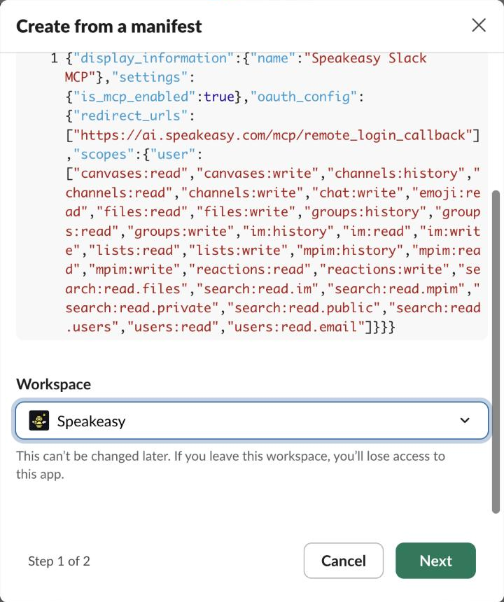
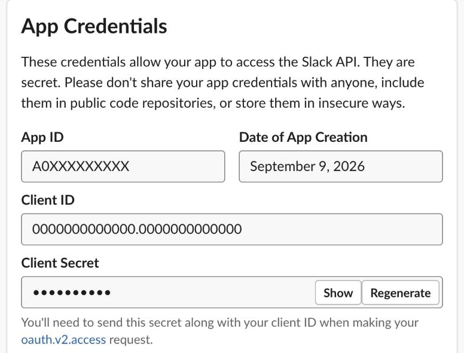

# Slack setup

You’ll need:

- Permission to create or manage apps in the Slack workspace you want to connect.
- An administrator’s approval if your workspace requires it.
- If using an existing app, an internal app or one published in the Slack Marketplace. Unlisted distributed apps are not supported.
- If the app uses an IP allowlist, a network administrator who can add Speakeasy’s outbound addresses while keeping the restriction in place.

<!-- manual-setup-start -->

[Create an app from a manifest](#automatic-setup), or [configure an app yourself](#manual-setup). After either option, copy the app credentials into Speakeasy. You only need to complete one option.

## Choose a setup method

- [**Guided setup (recommended)**](speakeasy.md#guided-setup) walks you through configuration in Speakeasy and shows you what to configure in Slack.
- **Manual setup**. Start with [Slack app configuration](#automatic-setup), then [add the server and configure its identity](speakeasy.md#add-server-in-speakeasy).

## Create an app from a manifest {#automatic-setup}

### Create your Slack app {#create-app-from-manifest}

Create a new app with MCP enabled, the deployment callback registered, and all
30 supported user scopes included. No JSON entry or manual configuration is
needed.

<div class="not-content">
<a class="not-content relative inline-flex items-center justify-center gap-2.5 rounded-full bg-neutral-800 !text-white px-5 py-2 font-mono text-[15px] leading-[1.6] uppercase transition-all dark:bg-[#F8F8F8] dark:!text-neutral-800 focus-visible:ring-1 focus-visible:ring-offset-3 focus-visible:ring-[#979797]" href="https://api.slack.com/apps?new_app=1&amp;manifest_json=%7B%22display_information%22%3A%7B%22name%22%3A%22Speakeasy+Slack+MCP%22%7D%2C%22settings%22%3A%7B%22is_mcp_enabled%22%3Atrue%7D%2C%22oauth_config%22%3A%7B%22redirect_urls%22%3A%5B%22{{ gram.oauth.callback_url }}%22%5D%2C%22scopes%22%3A%7B%22user%22%3A%5B%22canvases%3Aread%22%2C%22canvases%3Awrite%22%2C%22channels%3Ahistory%22%2C%22channels%3Aread%22%2C%22channels%3Awrite%22%2C%22chat%3Awrite%22%2C%22emoji%3Aread%22%2C%22files%3Aread%22%2C%22files%3Awrite%22%2C%22groups%3Ahistory%22%2C%22groups%3Aread%22%2C%22groups%3Awrite%22%2C%22im%3Ahistory%22%2C%22im%3Aread%22%2C%22im%3Awrite%22%2C%22lists%3Aread%22%2C%22lists%3Awrite%22%2C%22mpim%3Ahistory%22%2C%22mpim%3Aread%22%2C%22mpim%3Awrite%22%2C%22reactions%3Aread%22%2C%22reactions%3Awrite%22%2C%22search%3Aread.files%22%2C%22search%3Aread.im%22%2C%22search%3Aread.mpim%22%2C%22search%3Aread.private%22%2C%22search%3Aread.public%22%2C%22search%3Aread.users%22%2C%22users%3Aread%22%2C%22users%3Aread.email%22%5D%7D%7D%7D" target="_blank" rel="noopener noreferrer">Create app in Slack ↗</a>
</div>

1. Click **Create app in Slack**, select your workspace, and review the app.
2. Create the app. Continue to [Copy the app credentials](#copy-client-credentials).
   You can skip **Configure an app yourself**.

The default includes all 30 read, search, and write scopes. To limit access,
remove unneeded scopes from the manifest before creating the app. Tools that
need those scopes will be unavailable. Use the same restricted set when
[connecting the credentials](speakeasy.md#connect-speakeasy-credentials).
Workspace approval and each user's existing access restrictions still apply.

<!-- screenshot: Slack app creation with the prefilled manifest and workspace selection -->



## Configure an app yourself {#manual-setup}

Use this option if you already have an internal Slack app or want to configure the settings yourself. Skip it if you used the prefilled manifest above.

<details>
<summary>Show app configuration instructions</summary>

### Create an app from JSON {#create-app-manually}

For a new app, select **From a manifest** in
[Slack's app settings](https://api.slack.com/apps). Select the workspace, paste
the JSON below, review it, and create the app. Then continue to
[Copy the app credentials](#copy-client-credentials); the JSON already sets MCP,
user scopes, and the callback.

If you are configuring an existing app, skip the JSON and start at
[Enable MCP access](#enable-mcp-access).

<details>
<summary>View the full app manifest (30 user scopes)</summary>

```json
{
  "display_information": {
    "name": "Speakeasy Slack MCP"
  },
  "settings": {
    "is_mcp_enabled": true
  },
  "oauth_config": {
    "redirect_urls": [
      "{{ gram.oauth.callback_url }}"
    ],
    "scopes": {
      "user": [
        "canvases:read",
        "canvases:write",
        "channels:history",
        "channels:read",
        "channels:write",
        "chat:write",
        "emoji:read",
        "files:read",
        "files:write",
        "groups:history",
        "groups:read",
        "groups:write",
        "im:history",
        "im:read",
        "im:write",
        "lists:read",
        "lists:write",
        "mpim:history",
        "mpim:read",
        "mpim:write",
        "reactions:read",
        "reactions:write",
        "search:read.files",
        "search:read.im",
        "search:read.mpim",
        "search:read.private",
        "search:read.public",
        "search:read.users",
        "users:read",
        "users:read.email"
      ]
    }
  }
}
```

</details>

If the callback placeholder has not been filled in, replace it with your
deployment's OAuth callback URL before creating the app. You can remove scopes
you do not need, but keep the same scope set in Speakeasy.

<!-- screenshot: Slack's From a manifest flow with the full configuration -->

### Enable MCP access for an existing app {#enable-mcp-access}

For an existing app, complete these three configuration steps.

1. Open the app in [Slack's app settings](https://api.slack.com/apps).
2. Select **Agents** in the sidebar.
3. Turn **Slack Model Context Protocol (MCP) Server** **On**.

<!-- screenshot: Agents with Slack Model Context Protocol (MCP) Server enabled -->

### Set user permissions for an existing app {#set-user-permissions}

1. Select **OAuth & Permissions** and find **Scopes**.
2. Add the 30 scopes in the manifest above to the **user-token** scopes, not
   the bot-token scopes. To limit access, use only the scopes for the tools
   you need, from [Slack's tool-to-scope table](https://docs.slack.dev/ai/slack-mcp-server/#oauth-scopes-needed-on-user-token-for-different-tools).
3. Use the same selected scopes in Speakeasy.

Changing access in Speakeasy does not update an app already created
in Slack. Update the app's scopes in Slack too, then complete any required
reinstallation, approval, or user authorization before using the new permissions.

<!-- screenshot: OAuth & Permissions with the selected user-token scopes -->

### Register the callback for an existing app {#register-callback}

1. On **OAuth & Permissions**, find **Redirect URLs**.
2. Add `{{ gram.oauth.callback_url }}` and save.

<!-- screenshot: Redirect URLs with the deployment callback registered -->

</details>

## Finish app setup {#finish-app-setup}

Complete this step after either app configuration option.

### Copy the app credentials {#copy-client-credentials}

1. In the Slack app, open **Basic Information** and find **App Credentials**.
2. Copy **Client ID** and **Client Secret** for the
   [Speakeasy identity settings](speakeasy.md#connect-speakeasy-credentials).
   Reveal the secret if needed. Do not share it in chat, screenshots, or source
   control.
3. [Save the configuration in Speakeasy](speakeasy.md#connect-speakeasy-credentials).

Use these client credentials, not the App ID or a bearer token. No app
configuration token is needed for the prefilled creation link.

<!-- screenshot: Basic Information with Client ID and Client Secret labels; values redacted -->


