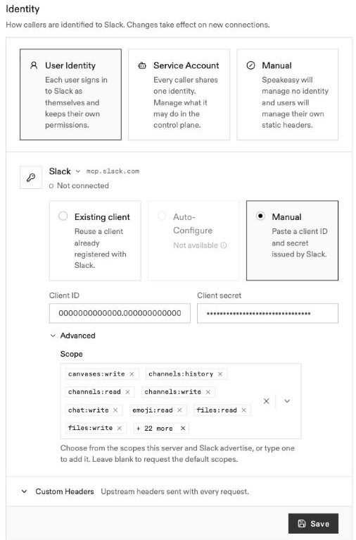
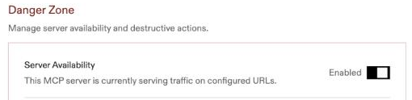

# Speakeasy setup

## Connect in the Control Plane

### Add the server in Speakeasy {#add-server-in-speakeasy}

1. In the sidebar, under **MCP Gateway**, select **MCP** and click **Add new**.
2. Choose **Hosted remotely**. In **MCP server URL**, enter:

   ```text
   https://mcp.slack.com/mcp
   ```

3. Optionally enter a display name. Leave **User session issuer** at its default
   and click **Verify connectivity**.
4. Keep **User Identity** selected. If **Guardrails** appears, leave it off.
   Click **Save**.

The server stays **Disabled** until you finish identity setup. Open its
**Settings > Identity** to configure the app credentials.

<!-- screenshot: New remote MCP server with Slack's endpoint and User Identity selected -->

### Connect your credentials {#connect-speakeasy-credentials}

1. [Create or configure the Slack app](external.md#create-app-from-manifest).
   The prefilled creation link already sets MCP access, all 30 user scopes,
   and the callback. Do not repeat those settings in Slack.
2. Under **Identity**, select **User Identity**. In **Choose an identity
   provider**, confirm Slack's issuer, `https://mcp.slack.com`, is selected.
   It is badged **Will be created** if the project has no Slack provider yet.
3. Choose **Manual**. Paste the [Client ID and Client Secret](external.md#copy-client-credentials).
   Slack requires the secret even if the field says **Optional**.
4. Open **Advanced** and open the **Scope** dropdown. Select the exact user
   scopes configured on the Slack app. For the full prefilled manifest, select
   all 30 scopes in the list.

   If you removed permissions in Slack, leave the same scopes unselected here.
   Do not leave **Scope** blank or select permissions that the app does not grant.

   <!-- screenshot: Settings > Identity with User Identity, Slack provider, Manual credentials, and full scopes; values redacted -->

   

5. Click **Save** and confirm with **Save changes** if asked.
6. In **Settings > Danger Zone > Server Availability**, turn on
   **Enable MCP server**.

   

When a person first uses the server, Slack asks them to authorize access with
their own account. Saving client credentials does not grant anyone access to
Slack data. If you change scopes after creating the app, update them in both
Slack and the Control Plane, then complete any required approval or authorization.

This guide covers setup only. For anything beyond it — billing, tool behavior, limits — see [Slack's MCP documentation](https://docs.slack.dev/ai/slack-mcp-server/).
